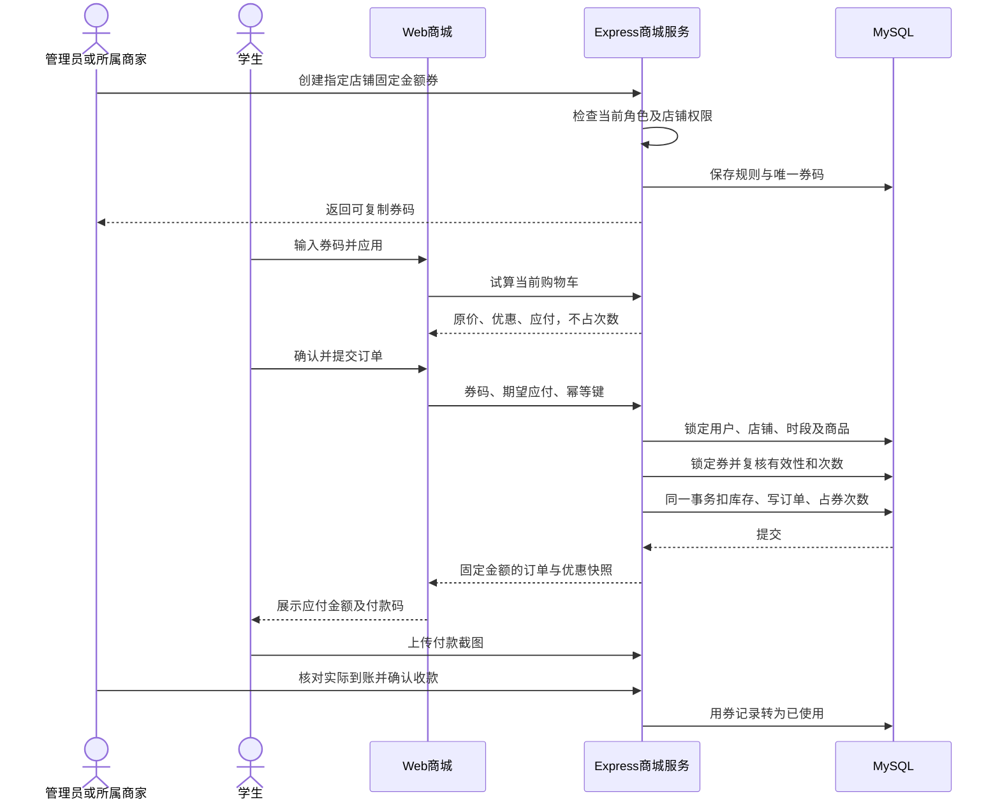
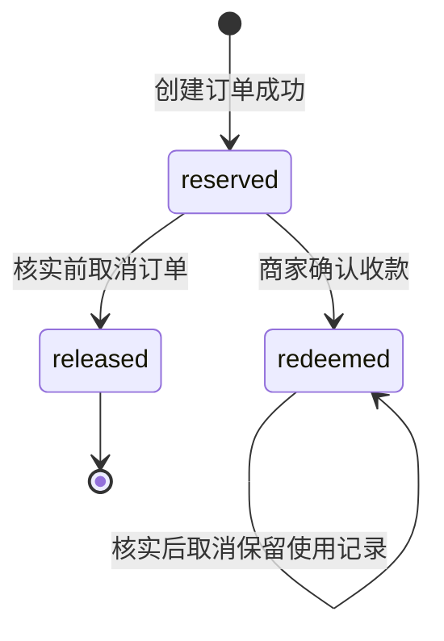
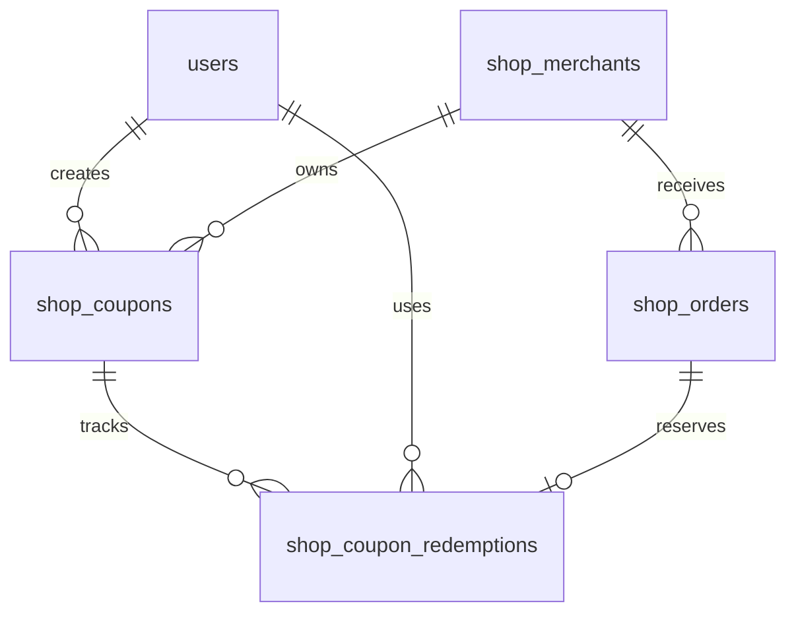

# 商城优惠券设计与实施计划

设计日期：2026-10-19。更新：2026-10-20。版本：1.1。状态：用户已授权，本地实现完成，待用户测试。
代码基线：远端 main `aca306d6`；本地 dev-sdc 已正常快进同步，其他未提交文档原样保留。
方法：指定 [easy-output 套件](https://github.com/yejianqin61-cell/easy-output) 的 easy-plan 与可读性规则。

**管理员或商家创建店铺固定金额券，学生在提交订单前输入券码，服务端计算减免并保存订单凭据。**
每张券仅适用一家店铺；线下转账与人工核实付款继续沿用。
优惠记录说明“为什么少付”，付款截图说明“提交了哪笔转账”，均不自动证明实际到账。
设计阶段只交付本文件；用户随后授权本地实施。实现和验证见[本地实施记录](../../07-Implement/校园商城/商城优惠券本地实施记录.md)。
2026-10-23：用户已授权个人分支提交与 PR，生产迁移、服务配置及部署仍待执行。

## 1. 已确认的需求与边界

| 项目 | 结论 | 来源 |
| --- | --- | --- |
| 发券人 | 管理员或商家 | 本次用户需求 |
| 使用方式 | 学生输入券码后减少应付金额 | 本次用户需求 |
| 优惠类型 | 固定金额，支持有门槛或无门槛 | 本次用户选择 |
| 店铺范围 | 每张券指定一家店铺 | 本次用户选择 |
| 工作顺序 | 最新代码分析后先写设计 | 本次用户需求 |

“发放”在本方案中指创建券码，再由发券人复制分享。学生不用先领券到钱包。
该交互已在本地实现；不增加邮箱、短信或站内群发。
范围为 Web 商城、现有 Express 后端、MySQL 和共享 API 的增量扩展；不修改 App 页面。
本版不做百分比折扣、跨店通用券、叠券、自动支付、自动退款和订单完成后追溯改价。

## 2. 当前仓库有哪些可复用能力

以下现状来自 `aca306d6` 的实际代码，不采用旧设计文档中的计划作为已实现事实。

| 状态 | 能力 | 仓库依据 |
| --- | --- | --- |
| 已实现 | React Web、查询缓存与中英文文案 | frontend/package.json；Shop.jsx |
| 已实现 | 价格、库存、营业时段服务端复核 | services/shop.js：checkout |
| 已实现 | 整数 MYR 分和订单快照 | 迁移 071；services/shop.js |
| 已实现 | 用户锁、事务与下单幂等键 | checkout；shared/api/shop.js |
| 已实现 | 商家成员权限、数据库角色检查 | routes/shop.js：currentAdmin |
| 已实现 | 店铺管理和管理员店铺列表 | ShopAdmin.jsx；ShopStoreAdmin.jsx |
| 已实现 | 截图上传、私有读取、人工核实 | ShopPayment.jsx；订单 proof 路由 |
| 已实现 | 单笔及批量状态推进 | changeStatus；ShopOrderBatch.jsx |
| 未实现 | 券码、优惠规则及用券次数模型 | services、routes、shared、迁移检索 |
| 未实现 | 结账优惠试算与优惠金额行 | Shop.jsx：Checkout 和订单详情 |

当前 Checkout 直接按购物车金额显示付款二维码，再提交订单。
`checkout` 把地址、时段、预期金额、店铺、付款方式纳入请求指纹，目前没有券码。
`total_cents` 是订单总应付金额；`payment_json` 是付款配置快照，不是支付流水。
`changeStatus` 确认收款时检查截图存在，取消订单时返还库存；尚无用券次数的处理。
再来一单只回填商品到购物车，不复用历史价格。

代码位置：`frontend/src/pages/Shop/Shop.jsx`、`ShopAdmin.jsx`、`ShopStoreAdmin.jsx`、`ShopPayment.jsx`。
后端位置：`routes/shop.js`、`services/shop.js`、`services/auditLog.js`、`shared/api/shop.js`。
模型依据：`migrations/071_campus_shop.sql`、`072_shop_merchants.sql`、`075_shop_store_soft_delete.sql`。

## 3. 推荐方案与金额证据

### 3.1 先锁定订单金额，再转账

优惠试算不占券。若试算后立刻显示二维码，学生可能先转账，提交时券却已过期或用完。
因此推荐结账页保留付款方式选择，把实际二维码展示放到订单创建成功后的付款页。
订单创建的同一事务完成商品扣库存、占用券次数、保存应付金额。
订单付款页再显示不可变的应付金额、收款码和上传截图入口。

这项顺序调整列入待确认事项；旧订单不重新计算优惠，也不修改已有付款快照。
目前“上传截图后显示下单成功”的交互继续保留，创建后未传截图的页面提示“订单已创建，待付款”。
优惠券不改变开放下单日期、库存和收货地址校验；没有券码的订单继续走原价流程。

### 3.2 金额计算建议

所有金额使用整数 MYR 分，显示层再转为 RM；不使用浮点金额参与结账。

```text
商品原价 = Σ(服务端商品单价 × 数量)
符合门槛：商品原价 >= 最低消费金额
优惠金额 = 券配置的固定减免金额
应付金额 = 商品原价 - 优惠金额
```

当前配送费为 0，本版优惠仅作用于商品金额，不新增配送费配置。
建议优惠后至少保留 RM 0.01；减免额大于或等于商品原价时提示不可用，不悄悄缩减券面金额。
零元订单涉及截图要求和收款状态变化，待用户决定，本版方案暂不支持。
建议每单一张券，每个账号每张券一次；总次数与有效期由发券人设置。

例：商品 RM 20.00，满 RM 15.00 减 RM 5.00，应付 RM 15.00。
付款页、学生历史、商家订单详情都读取该订单保存的原价、减免、应付与券码摘要。
商家之后改商品价格或停用券，不改变已创建订单的金额。
这些记录是系统核算依据，不是税务发票、银行收款回执或真实到账证明。

### 3.3 方案取舍

| 方案 | 优点 | 代价 | 结论 |
| --- | --- | --- | --- |
| 共享券码、无需领券 | 表单少，适合校内分享 | 持码人均可能使用 | 推荐第一版 |
| 个人券钱包 | 可定向发放 | 新增领取与分配流程 | 后续按需扩展 |
| 只记录前端折扣 | 实现快 | 可篡改、无法控制次数 | 不采用 |
| 服务端试算并在订单中保存 | 可复核、可控制并发 | 需要数据库迁移 | 推荐 |

不引入 Redis、消息队列或新的支付平台。现有 MySQL 事务足以处理首版计数与用券一致性。

## 4. 用户、商家、管理员如何联动

### 4.1 页面入口

- 商家：在现有店铺管理页增加“优惠券”标签，显示所属店铺的券、剩余次数和使用情况。
- 管理员：在现有商城店铺管理中增加“优惠券”入口，先选有效店铺，再创建或停用券。
- 学生：在购物车结账金额区增加“优惠码”输入框、“应用”和“移除”。
- 订单：学生与商家在金额区查看原价、优惠、应付与券码，原有状态按钮不变。

发券表单建议包含：名称、指定店铺、固定减免、最低消费、开始及结束时间、总次数。
商家的指定店铺由当前管理页固定，管理员可选择店铺。
每人限用一次为建议默认值，避免再增加首版表单项；开放次数编辑需用户另行决定。
券码由服务端随机生成 12 位大写字母数字，建立全局唯一索引；复制按钮方便分享。
创建请求需防重复标识，重试返回同一券码，不能连续生成多张券。
首版券的金额、门槛、店铺、有效期和总次数创建后不修改；要改规则就停用旧券并新建。

### 4.2 学生操作与结果同步

学生输入券码后，后端基于当前购物车返回试算金额。购物车数量或商品价格变化后，旧试算失效。
结账请求传标准化券码与期望应付金额；服务端重算，不接受浏览器提交的减免额。
试算失败保留输入并说明原因；不静默按原价提交，也不自动换成别的券。
订单创建成功后，显示固定应付金额供学生转账；截图上传与核实沿用现有能力。
再来一单仅回填商品，必须重新输入并验证券码，不自动继承历史优惠。
商家订单轮询和学生订单轮询继续使用现有查询，金额展示统一消费订单快照。



## 5. 权限、安全与业务状态

管理员创建和停用任意有效店铺的券；商家仅操作成员关系授权的店铺。
学生只能试算自己的购物车、查看自己的优惠订单，不可读取其他学生的用券记录。
后端从 JWT 获得用户编号，并查询数据库当前角色、账号状态和商家成员关系。
不能信任浏览器传来的 merchant_id、created_by、discount_cents 或角色。
管理员 Web 入口需独立角色检查，不能要求管理员伪装为商家成员才能使用。

券码先 trim 再转大写，只接受 8–24 位 ASCII 字母数字；生成固定为 12 位。
普通学生只能验证输入的券码，不提供可枚举的券目录或剩余数量。
无效、其他店铺和停用券对学生统一提示“优惠码不可用”；管理端可查看具体原因。
新增试算接口做账号与 IP 双维度限流，建议初值每账号每分钟 20 次，超限返回 429。
规则写入、停用与订单核销写审计，不记录密码、收货详情和完整截图；服务端错误不泄露 SQL。
券码只放请求体，不放 URL；新审计只记录券编号，不记录完整券码。

券的持久状态只有 active、disabled；尚未开始、已过期、已用完由服务端时间和次数派生。
时间统一采用校园 Asia/Singapore，开始包含、结束不包含；不依赖学生设备时间。
用券记录状态建议如下，订单原有状态集合保持不变：



建议核实前取消返还次数；核实后取消不自动返还，防止退款未处理却重复使用。
线下退款仍由商家人工处理，本版不新增退款状态或自动退钱。
以上取消规则待用户确认。未付款订单目前没有自动过期任务，首版也不默认新增。
因此建议商家可取消长期未付款订单释放次数；自动释放时限留待业务确认。
停用券不撤销已创建订单；店铺软删除也保留历史券及订单快照。

## 6. 数据设计建议

以下都是计划新增，不是当前数据库已有模型。迁移编号在开发前 fetch 后重新确认，不在设计时占号。
复用 users、shop_merchants、shop_orders，不复制学生资料或付款截图。

### 6.1 shop_coupons：规则与计数

| 字段 | 类型及约束 |
| --- | --- |
| id | INT，主键 |
| merchant_id | INT NOT NULL，关联店铺 |
| code | VARCHAR(24)，ASCII 二进制排序，唯一 |
| name_zh、name_en | VARCHAR(120)，中英文名称 |
| discount_cents | INT UNSIGNED，大于零 |
| min_subtotal_cents | INT UNSIGNED，默认零 |
| starts_at、ends_at | DATETIME，校园时间，起点早于终点 |
| total_limit | INT UNSIGNED，大于零 |
| per_user_limit | INT UNSIGNED，建议固定为一 |
| reserved_count、redeemed_count | INT UNSIGNED，默认零 |
| status | VARCHAR(20)，active 或 disabled |
| created_by | INT NOT NULL，关联用户 |
| create_key | VARCHAR(80)，创建请求幂等标识 |
| create_hash | CHAR(64)，规则请求指纹 |
| created_at、updated_at | DATETIME |

索引：code 唯一；(created_by, create_key) 唯一；(merchant_id, status, created_at) 用于管理列表。
约束：reserved_count + redeemed_count 不得超过 total_limit，所有计数不得为负。
兼容项目 MySQL 最低版本，关键约束必须在持锁事务内执行，不能只依赖 CHECK。
不支持硬删除已发券，避免历史订单无法追溯。

### 6.2 shop_coupon_redemptions：每张订单的占用与核销

| 字段 | 类型及约束 |
| --- | --- |
| id | INT，主键 |
| coupon_id | INT NOT NULL，关联优惠券 |
| order_id | INT NOT NULL，关联订单，唯一 |
| user_id | INT NOT NULL，关联学生 |
| discount_cents | INT UNSIGNED，实际减免 |
| status | VARCHAR(20)，reserved/redeemed/released |
| redeemed_at、released_at | DATETIME，可空 |
| created_at、updated_at | DATETIME |

索引：(coupon_id, user_id, status) 校验每人限额；(coupon_id, status) 用于核销查询与对账。
同一订单只能有一条用券记录，后端须验证券店铺与订单店铺一致。
不使用 (coupon_id, user_id) 唯一约束，因为取消释放后可能允许同一人重新使用。

### 6.3 shop_orders：金额与优惠快照

建议增量增加 subtotal_cents INT UNSIGNED NULL、discount_cents INT UNSIGNED NULL、coupon_json JSON NULL。
新增订单显式写原价、减免与券快照；无券订单的 discount_cents 为 0。
保持 total_cents 表示应付金额，避免破坏历史、商家列表及付款页已有用法。
coupon_json 保存券编号、券码、中英文名称、规则及实际减免，不保存学生隐私。
旧订单新字段为 NULL 时按“原价 = 原 total_cents，减免 = 0，无券”展示，不整库重算旧订单。
商品行快照仍保存原单价，订单详情另列优惠行，不能把折扣隐含写进商品单价。
decode、订单响应、幂等恢复、历史详情、商家详情与再来一单需共同检查兼容。



## 7. 接口职责建议

新接口必须保持现有 `{ status: 0, data: ... }` 和失败 `{ status: -1, message, code? }` 格式。
下表是建议契约，当前仓库还没有 coupons 或 checkout-quote 路由。
表中店铺前缀 B 表示 `/api/shop/stores/:slug`。

| Method / 路径 | 身份与职责 |
| --- | --- |
| POST B/checkout-quote | 登录学生；校验自己购物车及券码，不占券 |
| POST B/admin/coupons | 当前管理员或所属商家；创建固定规则券 |
| GET B/admin/coupons | 当前管理员或所属商家；分页查看该店券 |
| PATCH B/admin/coupons/:id/status | 同上；启用或停用，拒绝跨店 |
| GET B/admin/coupons/:id/redemptions | 同上；分页查看核销及关联订单 |
| POST B/orders | 修改现有结账，增加可选 coupon_code |
| GET B/orders/:id | 保持权限，增加金额与券快照 |
| PATCH B/admin/orders/:id/status | 保留状态接口，原子更新核销记录 |

创建输入：name_zh、name_en、discount_cents、min_subtotal_cents、starts_at、ends_at、total_limit。
创建使用 `Idempotency-Key` 请求头，返回 id、code、status、规则、计数和时间；重复同内容返回原券。
管理列表分页 page、page_size（上限 50）；不返回完整学生地址和截图。
状态更新输入 status 只能是 active 或 disabled；同目标重复请求返回当前结果。

试算输入：coupon_code（空值表示无券）、slot_id、payment_method。
服务器读取购物车及当前价格，返回 subtotal_cents、discount_cents、total_cents、coupon 摘要与 server_time。
试算仅供确认，不签发“保证可用”的 token，也不修改库存或次数。
结账维持 address、slot_id、payment_method、expected_total_cents，额外接收可选 coupon_code。
结账成功仍返回 `{ order, replayed }`，订单额外携带新金额字段。

| HTTP / code | 场景及学生反馈 |
| --- | --- |
| 400 INVALID_INPUT | 格式、金额或时间不合法 |
| 401 / 403 | 未登录、停用账号、无管理权限 |
| 404 | 无权限查看的具体券或订单 |
| 409 COUPON_UNAVAILABLE | 券失效、满额或每人限额已用完 |
| 409 COUPON_MIN_NOT_MET | 未满足最低商品金额 |
| 409 COUPON_PAYABLE_TOO_LOW | 优惠后不足最小应付 |
| 409 PRICE_CHANGED | 金额已变，要求重新确认 |
| 409 IDEMPOTENCY_CONFLICT | 同请求键用于不同内容 |
| 429 | 券码试算过于频繁 |
| 500 / 503 | 服务异常，保留输入并允许重试 |

shared/api/shop.js 仅增量增加方法，不修改现有方法含义；开发时检查共享层消费者，不改 App 业务。

## 8. 并发、幂等与一致性

1. 结账先锁用户，检查同一幂等键已有订单，再执行当前商品、时段和用券校验。
2. 标准化后的券码纳入请求指纹；同键不同券或不同应付返回 409，不能返回错误订单。
3. 已提交订单的重放优先返回原订单，不因券后续停用或过期再次扣次数。
4. 保留现有店铺、时段及商品锁；商品锁按编号排序，在扣券前再锁优惠券行。
5. 持券行锁读取总计数；每人限额采用当前锁定读，不使用旧事务快照 COUNT。
6. 只有 reserved 与 redeemed 计入总限额与每人限额；released 不占次数。
7. 写订单、插入 reserved 记录、增加 reserved_count、扣库存放在同一个事务中。
8. 任一失败回滚全部修改；两个学生抢最后一次机会只能一人成功。

券新增后，checkout 与取消路径都按“已有业务锁 → 按编号排序的商品锁 → 券锁”处理。
取消先锁原订单，按现有规则还库存，再锁券与用券记录并按旧状态决定是否释放。
确认收款先锁订单及核实凭证，再锁券与用券记录，将 reserved 原子转为 redeemed。
规则管理只锁券，不反向锁订单或商品；开发时需复查各路径锁图并测试死锁回滚。
计数变化与用券记录状态变化必须在同一事务提交；相同订单状态重复请求不得再次改计数。
批量推进继续逐单调用原接口，自动继承相同核销逻辑，不新增前端“直接核销券”能力。

网络超时后保留原幂等键，先调用现有 `/requests/:key` 恢复订单，再决定是否重试。
请求结果不明确时冻结该次请求内容；查清结果前不允许换券后复用原键。
服务端最终金额与试算不符时回滚并提示，不自动按新的更高金额创建订单。
券的规则创建后不可改，因此已成功订单只依赖快照，不依赖当前规则重算。

## 9. 迁移、部署与回退建议

本优惠券功能将需要新增数据库迁移，与上一次图片和批量订单无需新增字段的结论不同。
计划新增两张券表和订单可空字段；不要复用旧迁移编号，不手工改生产结构。
先在隔离本地数据库验证迁移可重跑、旧订单默认显示及事务回滚，再安排目标环境执行。
上线前只做必要的结构和计数核查，不抓取真实学生订单到测试数据，不把环境文件写进 Git。
部署顺序为兼容字段迁移、支持新旧订单的后端、Web；前端早部署时必须处理新接口尚不可用。
若迁移缺失，新券入口保持不可用并给出维护提示，不能导致原价订单全部报错。

可使用默认关闭的 SHOP_COUPONS_ENABLED 特性开关控制试算及新券订单；旧请求仍可原价下单。
开关仅阻止新发券和新用券，已有订单的优惠显示、确认核销和取消释放必须继续运行。
若需要回退，关闭新券入口并回退兼容版本，不删除券表和历史快照。
不能直接回退到完全不认识优惠券的旧后端，否则取消、确认将漏改计数。
已付订单人工退款不在迁移或回退脚本内处理。

## 10. easy-plan：需求清单

- R-1 授权发放店铺固定金额券：来自用户本次需求与两项范围确认。
- R-2 学生用券并确认实付：来自学生输入券码减少付款金额的需求。
- R-3 优惠记录可供双方核对：来自“减少金额的证明”及现有人工核实流程。
- R-4 并发与重复操作一致：来自现有下单事务、幂等与权限要求。
- R-5 兼容迁移与分阶段交付：来自设计先审阅、现有功能兼容及项目迁移规则。

## 11. easy-plan：逐项施工方案

### R-1 授权发放店铺固定金额券

- 方案：管理员选店、商家固定自己的店，创建后复制分享券码，可停用。
- 触及模块：商城管理、商家权限、规则与审计。
- 测试接缝：现有商城路由授权测试与管理页面。
- 验收：两类授权角色可发券；学生及其他店商家被拒绝；重复创建返回原券。
- 难点：管理员入口与商家成员入口需要分别正确判权。

### R-2 学生用券并确认实付

- 方案：先服务端试算，再在下单事务重算，成功后展示固定金额付款码。
- 触及模块：购物车结账、商城金额服务与订单付款页。
- 测试接缝：现有结账服务及订单路由。
- 验收：满足门槛正确减免；错误券不默默原价下单；购物车变化使旧试算失效。
- 难点：不能让学生按尚未占用次数的试算结果先付款。

### R-3 优惠记录可供双方核对

- 方案：保存原价、减免、应付及券快照，与付款截图分开展示。
- 触及模块：订单数据、学生详情、商家详情与批量推进。
- 测试接缝：现有订单读取、确认收款与页面展示。
- 验收：双方金额一致；历史快照不随规则变化；截图不被当成自动到账结果。
- 难点：旧订单缺新字段时仍须正常展示，不能伪造历史优惠。

### R-4 并发与重复操作一致

- 方案：锁定券与用券记录，所有计数随订单事务变更，复用请求幂等。
- 触及模块：结账事务、取消、确认收款与请求恢复。
- 测试接缝：现有订单服务加隔离 MySQL 并发集成测试。
- 验收：最后一次仅一人成功；同键不重复扣券；取消及重复状态操作计数正确。
- 难点：死锁、响应丢失和批量操作的逐单失败不能造成计数漂移。

### R-5 兼容迁移与分阶段交付

- 方案：增加兼容字段和默认关闭开关，先验证再分支 PR 交付。
- 触及模块：数据库迁移、配置、回归测试与交付说明。
- 测试接缝：迁移运行器、现有测试命令、Web 构建与浏览器。
- 验收：旧订单及无券流程不变；迁移可重跑；关闭新券仍可处理历史优惠订单。
- 难点：旧后端无法正确处理新券计数，回退版本必须兼容。

## 12. easy-plan：实施阶段

### Phase 1：一个券码贯通下单与付款

覆盖 R-1 授权发放店铺固定金额券、R-2 学生用券并确认实付、R-5 兼容迁移与分阶段交付。
目标：在隔离本地环境演示“商家发券 → 学生用券 → 保存应付金额 → 付款页”。

- 打通一张店铺券从授权创建、试算到带快照订单的最小流程。
- 增加可重跑迁移、兼容字段及默认关闭开关。
- 复用现有权限、金额和 UI 组件，补齐管理员选店入口。
- 把实际付款码放到订单金额固定后显示，并提供移除券操作。
- 验证有券、无券、未达门槛、停用及过期场景。

验证：服务端路由测试和本地浏览器走通上述流程，核对金额恒等式。
排除：并发压测、百分比、叠券、真实支付和线上数据库操作。

### Phase 2：从核实到取消始终可核对

覆盖 R-3 优惠记录可供双方核对、R-4 并发与重复操作一致。
目标：重复请求及取消后，订单金额、库存和券次数一致。

- 打通同一用券订单确认收款、再次确认和取消后的记录核查流程。
- 增加核销及释放事务，复用批量推进现有接口。
- 验证两人争最后一次与同账号重复下单。
- 验证网络结果不明确时的原键恢复和不同券指纹冲突。
- 展示学生历史、商家详情与券使用记录，覆盖旧订单回退显示。

验证：真实隔离 MySQL 并发测试、服务回归及双方页面金额比对。
排除：自动超时释放、自动退款和财务结算系统。

### Phase 3：兼容发布与用户验收

覆盖 R-5 兼容迁移与分阶段交付，并复核全部需求。
目标：用户先测本地，再经个人分支 PR 和明确发布检查交付。

- 打通旧订单读取、无券下单、新券下单到关闭开关后的验收流程。
- 运行根目录测试、Web 检查及构建，记录无法验证的环境条件。
- 核查权限、限流、审计、迁移重跑和兼容回退。
- 交付用户本地测试，收集意见后完善设计与实施记录。
- 经用户授权后再次 fetch，提交 dev-sdc 并提出 main PR。

验证：逐条验收记录、迁移结果、截图及 PR 差异，不以构建通过代替业务验收。
排除：未授权推送、直接提交 main、自动合并和自动生产发布。

## 13. 待确认事项

| 决策 | 建议方案 | 影响 |
| --- | --- | --- |
| D-1 付款码展示顺序 | 建单固定金额后再展示 | 避免先付款后用券失败 |
| D-2 个人限额 | 同账号每券一次，不限制真实身份 | 多账号滥用需后续策略 |
| D-3 取消返券 | 核实前返还，核实后不自动返还 | 影响退款与重复用券 |
| D-4 零元订单 | 首版不支持，应付至少 RM 0.01 | 避免改变截图核实流程 |
| D-5 未付款长期占券 | 商家取消，首版无自动过期 | 防止券被长期占用需再评估 |
| D-6 发放方式 | 生成共享券码手动分享 | 不做个人钱包和自动通知 |

用户随后授权“根据文档内容开始做”，本地实现采用上表建议默认值；仍可在本地测试后调整。
未付款订单没有自动释放时限，需商家取消；正式发布前必须明确这一运营限制。

## 14. 本轮检查与变更记录

2026-10-19 已 fetch 并正常同步到最新 main，既有未提交文档仍保留。
已阅读指定套件 README、easy-plan 及引用规则；本地安装的 SKILL.md 与指定来源副本 SHA256 一致。
已检查当前价格计算、权限、付款码、订单幂等、截图、取消和批量状态实现。
本轮不修改可执行代码，不运行数据迁移、不触碰真实环境文件；不会把旧轮测试结果写成本轮验收。
文档交付前检查内部引用、Mermaid 图、需求与阶段覆盖，以及代码差异是否仍与 main 一致。

- 2026-10-19：基于最新代码和用户范围确认，完成待审设计及 easy-plan 实施计划。
- 2026-10-20：按用户授权完成本地优惠券功能和隔离验证，回写状态；未发布。


## 实施补充（2026-10-23）

商家与管理员可复制当前券码并生成下一张，继承名称、优惠、门槛与有效期，新券总次数为 1。
原券及其次数不变，券码仍不绑定指定学生。代码复用原有幂等创建 API，无额外迁移。
学生付款说明改为订单进度语言，不改变收款确认、核销或取消返还规则。
当前交付及实际验证见[发布说明](../../07-Implement/校园商城/商城优惠券与付款体验发布说明.md)。
