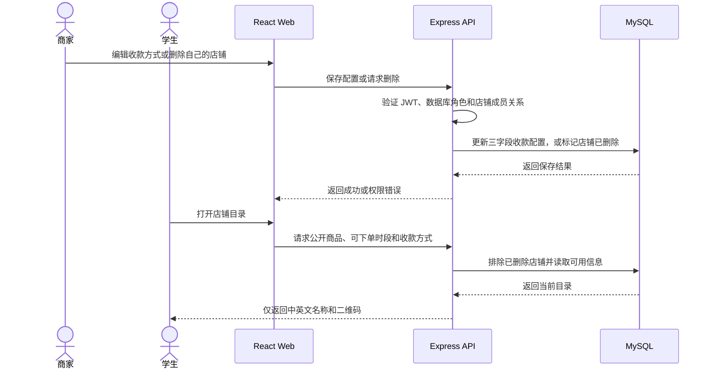

# 校园商城店铺管理与收款设计

日期：2026-10-14　版本：1.0　状态：待评审

## 结论

沿用现有 Express、MySQL、JWT 和商城管理页面。店铺删除采用带权限检查的软删除；商家只能删除自己的店铺，管理员可以删除任意有效店铺。付款方式仅保留中文名称、英文名称和二维码地址。本地账号与商城数据清理属于一次性操作，须连接已确认的本地数据库并先备份；本轮因本地 MySQL 不可写，尚未执行。

范围包括 Web 商家删除自有店铺、管理员删除店铺、精简收款方式，以及用户明确要求的本地全量账号和商城关联数据清理。范围不包括生产数据库清理、支付网关、账号体系重做、自动退款或商家审核流程。

## 现状与依据

- **已实现**：商城 API 位于 Express 路由；`shop_merchants`、`shop_merchant_members`、商品、时段、订单及付款截图使用现有 MySQL 表。
- **已实现**：用户通过现有 JWT 登录。服务端读取当前数据库角色，并检查商家与店铺的成员关系。
- **已实现**：商家店铺删除入口只将店铺停用并写入 `deleted_at`。管理员删除路由使用相同的软删除方式。
- **已实现**：迁移 075 为店铺增加软删除字段。公开商城查询排除已删除店铺。
- **已实现**：商家收款配置使用名称和二维码上传组件，图片沿用现有图片存储配置。
- **需补齐**：旧版收款数据包含备注字段。服务端曾保存并返回这些字段；本次改为读写只含三项的收款方式。
- **未完成**：本地实例的数据清理。仓库本地数据目录存在，但启动失败且生产连接串在 `.env` 中；本次不使用该连接串。
- **待确认**：无新增营业规则。学生地址继续由学生提交，订单状态继续使用当前状态机。

现状依据：`routes/shop.js`、`services/shop.js`、`migrations/075_shop_store_soft_delete.sql`、`frontend/src/pages/Shop/ShopStoreAdmin.jsx`、`frontend/src/pages/Shop/ShopSettingsFields.jsx` 及对应商城路由测试。

## 设计说明

### 目标和边界

普通学生不能修改店铺、商品或订单。商家可以关闭自己管理的店铺；管理员可以从商城管理页关闭任意有效店铺。删除后店铺停止公开访问和新下单，数据库保留历史订单和付款凭证，方便履约记录查询。

本地数据清理与应用内店铺删除分开处理。清理范围是本地数据库内全部账号、全部店铺及店铺关联数据，包括商品、时段、购物车、订单和付款截图。清理前需确认连接主机为回环地址、库名为 `xmumdorm_demo`，并创建可恢复的本地备份。清理不包括校园社交、食堂等其他模块数据；若其他表通过账号外键关联用户，脚本须先列出关联并按外键约束处理，不能盲目清空整库。

### 推荐方案和取舍

继续使用已有店铺软删除，避免删除后破坏订单快照、历史付款信息或审计记录。它是可恢复的业务动作，不等同于用户本次要求的一次性本地数据清理。

权限继续使用数据库中的当前角色和店铺成员关系。API 在写入前校验身份与归属，避免仅依赖浏览器隐藏按钮。无需新增权限服务或角色。

收款方式由服务端统一规范化为 `id`、中文名称、英文名称和二维码地址。`id` 由服务端生成；旧备注被读取时丢弃，避免旧数据继续显示给学生。付款截图上传与既有对象存储或本地持久目录保持一致。

### 端到端联动

商家页提交配置后，API 验证每种方式的中英文名称、二维码 URL 和唯一标识，再保存规范化数据。公开目录仅在订单时段开放时返回付款码；时段关闭时继续隐藏付款码。订单创建时再次读取并校验已选收款方式，将配置快照写入订单，避免商家后续改码改变旧订单显示。

删除店铺时，商家请求绑定当前店铺；管理员请求绑定目标店铺 ID。服务端在事务中锁定目标行、复查权限并写入 `enabled=0` 和 `deleted_at`。重复删除返回“已删除”结果或明确的 404，不重复处理数据。目录查询排除该店铺，学生购物车中旧商品在结账时会因店铺或商品不可用而失败。

本地全量清理不经过公开 API。它应使用单独的一次性脚本：验证仅回环地址与指定库名、输出待删行数、备份、在事务内清理商城关联记录和用户关联记录、检查最终账号及店铺数量为零。脚本不得自动创建演示账号或店铺。

### 权限、异常和一致性

学生只访问公开目录及本人订单。商家只能管理自己成员关系覆盖的店铺。管理员权限从数据库当前角色读取，避免旧 JWT 角色在降权后继续生效。

所有删除写入放在事务内并锁定店铺行。并发重复删除不能产生部分删除。应用级软删除保留历史订单和审计线；本地全量清理则由备份提供恢复点，失败时回滚事务。

收款方式写入前限制数量、字段长度和图片 URL 协议；只允许本地路径或 HTTPS。上传接口继续校验图片内容、MIME 类型和文件大小。二维码内容由商家自行核验，系统不能证明二维码可收款。

网络中断时，页面应提示重试并重新读取店铺状态。重复保存同一收款配置为幂等更新。重复删除不得重复清理订单或图片。

### 兼容方式

不更改用户、商家、订单或付款截图表结构以支持本次字段精简。迁移 075 仅提供店铺软删除字段。已有订单保留付款快照；已有收款方式中的备注在新 API 响应中剥离，商家再次保存后旧备注不再写入。

本地数据清理不作为部署迁移。生产数据、生产账号和生产店铺不受影响。备份应放在 `.local/` 等已忽略目录，禁止提交备份、环境变量、密码、付款码或学生资料。

## easy-plan 实施计划

### 1. Requirements

- **R-1 商家删除自有店铺** — 本轮用户请求；商家只能删除自己管理的店铺。
- **R-2 管理员删除店铺** — 本轮用户请求；管理员可以删除任意有效店铺。
- **R-3 收款方式只保留三项** — 本轮用户请求；中文名称、英文名称和对应二维码。
- **R-4 清理本地全部账号及商城数据** — 本轮用户确认；仅限本地数据库并包含店铺关联数据。

### 2. The approach, requirement by requirement

#### R-1 商家删除自有店铺

- **Approach**：商家从自己的管理页删除当前店铺。服务端按当前数据库成员关系授权，并软删除店铺。
- **Touches**：商城管理页、商城 API、商家成员权限、店铺查询。
- **Test seam**：商城 HTTP 路由测试，覆盖所有权、状态和重复请求。
- **Acceptance**：[ ] 店主可删除自己的店铺；[ ] 非成员和学生收到 403；[ ] 已删除店铺不再公开。
- **Hard part**：旧购物车和历史订单引用已删除店铺时，结账须安全拒绝，历史订单仍可读取。

#### R-2 管理员删除店铺

- **Approach**：管理员后台列出有效店铺，并调用受当前数据库角色保护的删除接口。
- **Touches**：商城管理 API、管理员商城页面、审计日志。
- **Test seam**：商城 HTTP 路由测试，覆盖管理员和普通用户。
- **Acceptance**：[ ] 当前管理员可删除有效店铺；[ ] 商家不能调用全局删除接口；[ ] 操作写入审计记录。
- **Hard part**：不能信任 JWT 中过期的管理员角色。

#### R-3 收款方式只保留三项

- **Approach**：服务端在保存、目录响应和订单快照三个边界统一规范字段，并剥离旧备注。
- **Touches**：商家收款表单、商城 API、下单服务、学生付款页面。
- **Test seam**：商城 HTTP 路由与下单服务测试。
- **Acceptance**：[ ] 表单只要求中文名、英文名和二维码；[ ] 旧备注不返回；[ ] 订单快照不含备注。
- **Hard part**：旧数据库 JSON 数据可能包含不完整字段；无效方式不能误显示成可付款。

#### R-4 清理本地全部账号及商城数据

- **Approach**：连接已确认的本地数据库，先备份，再事务清除账号和商城关联记录。生产库必须被连接保护条件拒绝。
- **Touches**：本地 MySQL、一次性维护脚本、商城和用户关联表。
- **Test seam**：隔离本地 MySQL 数据库中的行数与回滚检查。
- **Acceptance**：[ ] 仅本地目标可运行；[ ] 备份存在且可读取；[ ] 全部账号、店铺、订单与付款截图计数为零。
- **Hard part**：本次环境无法启动本地 MySQL，清理前必须恢复本地可写访问。

### 3. Phases

#### Phase 1 — 店铺操作受权限保护

**Covers**：R-1 商家删除自有店铺，R-2 管理员删除店铺。

**Goal**：店主可从管理页删除自己的店铺，管理员可删除任意店铺，学生无法执行这两项操作。

**Tasks**

- 跑通店主、管理员和学生的删除 API 最小权限闭环
- 核对删除接口使用当前数据库角色和成员关系
- 验证事务锁、重复删除和审计记录
- 验证删除后公开目录与旧购物车的行为

**Proof**：路由测试证明授权差异；已删除店铺不再出现在公开目录。
**Not here**：本地全量清理和硬删除历史订单。

#### Phase 2 — 收款配置在商家和学生端一致

**Covers**：R-3 收款方式只保留三项。

**Goal**：商家保存三项收款信息后，学生在有效下单时段看到相同二维码，旧订单保留原付款快照。

**Tasks**

- 跑通商家保存到学生目录显示的收款配置最小流程
- 验证旧备注从保存结果、公开目录和新订单快照中剥离
- 验证非 HTTPS 外链和不完整二维码配置被拒绝
- 验证下单窗口关闭时学生看不到付款码

**Proof**：路由和订单服务测试覆盖新旧配置及窗口开关。
**Not here**：接入真实支付或识别二维码收款有效性。

#### Phase 3 — 本地清理有备份且可核验

**Covers**：R-4 清理本地全部账号及商城数据。

**Goal**：备份后的本地数据库不再包含账号、店铺和关联商城数据，其他校园模块保持完整。

**Tasks**

- 跑通本地数据库身份校验和待删行数预览
- 生成并验证本地数据库备份
- 在事务内删除店铺及其商品、时段、订单和付款截图
- 删除全部账号及其外键关联记录并核对剩余数据

**Proof**：本地验证查询证明账号和商城表为空，非商城表行数保持不变。
**Not here**：任何生产数据库写入、恢复演示账号或重新创建店铺。

## 变更记录

- 2026-10-14：依据当前商城实现和用户确认范围编写设计与实施计划。
- easy-output 来源：`yejianqin61-cell/easy-output` 中的 `easy-plan` 与可读性规则已读取并用于本文件。全局安装命令未运行：当前环境无 `npm`/`npx` 可执行文件；本文件不宣称安装成功。
