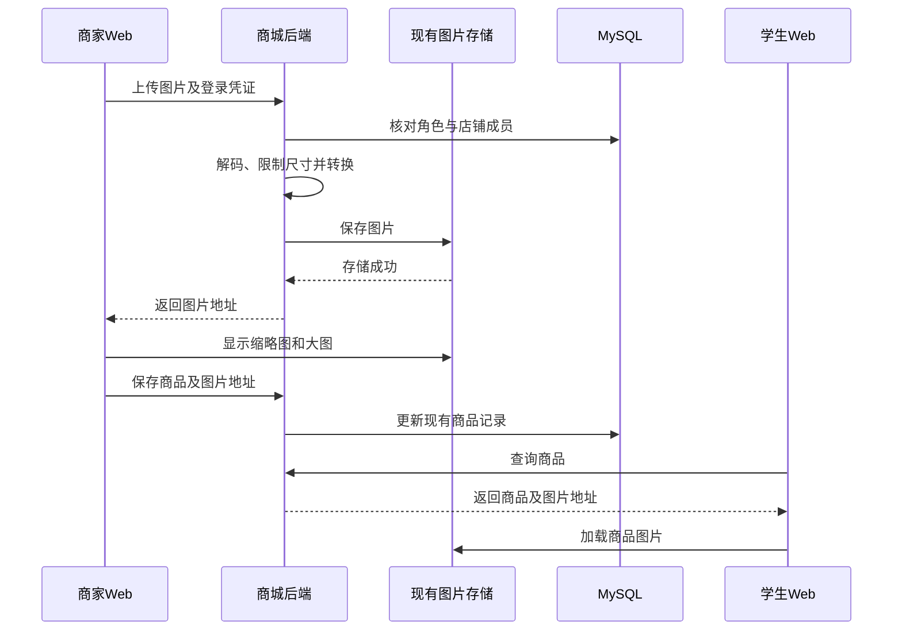
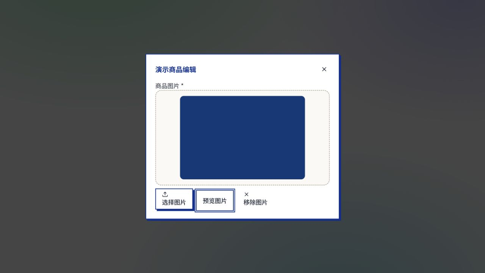

# 商城商品图片持久化与预览修复设计

类型：设计说明与实施计划。日期：2026-10-14。版本：1.0。状态：已实现，待 PR 审阅与部署。
初始基线：main `149a94e8`；交付前已同步至 `18cd0797`。范围：Web 商城及后端商品图片接口。

**新商品图复用现有对象存储，旧图兼容跨域读取，Web 统一缩略图与大图预览。**
无需新增数据库表或列；历史图片通过单独的数据迁移脚本处理。
后端和前端都需要部署，推送分支本身不会改变线上上传行为。
商品 ID 4 的旧文件已返回 404，需要商家重新上传，代码无法恢复丢失字节。

## 根因是什么？

2026-10-14 的线上检查确认：

| 问题 | 仓库依据或实测证据 | 后果 |
| --- | --- | --- |
| 相对地址发往前端域名 | 原 Shop 页面直接使用 image_url | 返回 SPA 的 HTML |
| 后端限制跨域图片 | server.js 的 Helmet 默认策略 | HTTP 200 仍不能嵌入页面 |
| 上传只落后端磁盘 | 原 routes/shop.js 的 diskStorage | 临时文件可能在部署后丢失 |

仅补后端域名不能修复全部问题。此前模拟接口没有 Helmet，因此漏掉第二项。
本次在真实路由前启用 Helmet，并使用不同端口的 Web 页面验证。
对 404 文件只能确认当前不可读，不能断言是哪次部署删除。

## 商家上传后，学生如何看到图片？

入口仍是商家商品编辑窗口。选图和拖放调用现有上传接口：
`POST /api/shop/stores/:slug/admin/product-images`，multipart 字段为 `image`。
接口沿用登录、封禁检查、数据库角色和店铺成员校验。

`services/shopProductImage.js` 复用 Sharp，校验真实格式与 MIME 一致，限制 5 MB、1600 万像素。
图片自动旋转、最长边缩至 2400 像素，编码为 WebP；不再仅凭文件头判断有效性。
复用 `services/objectStorage.js`，保存到 `shop/products/{merchantId}/{随机名}.webp`。

成功响应保持 `{status:0,data:{url}}`。商家先看到缩略图，再通过现有保存接口写入商品的 `image_url`。
学生列表、详情和购物车读取同一字段；点击图片打开现有 `ImagePreview`。
商家增加“预览图片”；Esc 只关闭大图，保留商品编辑窗口。

`shopImageUrl` 调用现有 `getUploadUrl` 解析旧后端相对路径。
完整 HTTPS、blob、前端静态图片保持原样；加载失败展示现有默认图，不改写数据库。
`/api/shop/assets` 原本就是公开资源，仅该静态资源响应的 CORP 调整为 `cross-origin`。
全局 Helmet、登录权限和订单付款截图的私有访问控制保持不变。



## 为什么选择这个方案？

| 方案 | 能解决什么 | 限制 |
| --- | --- | --- |
| 只修改数据库地址 | 恢复已有图片记录 | 新上传仍会复发 |
| 只增加前端代理 | 路径和同源读取问题 | 无法保证文件持久保存 |
| 对象存储加旧图兼容 | 新图、旧图和预览 | 必须部署前后端，采用 |

不新增存储供应商或数据库图片二进制字段。
不修改 App、价格库存、支付流程或学生资料。
收款码共用展示组件，但不重写收款码上传接口。

## 权限、异常和重复操作如何处理？

- 未登录返回 401；学生和其他店铺商家返回 403，校验在文件处理前完成。
- 无效图片或超限返回 400；生产缺少持久化配置或公开 HTTPS 地址返回 503。
- 存储失败返回通用 500，不泄露凭据，不返回假成功 URL。
- 上传中禁用重复选图和商品保存；重复请求可能留下未引用图片，不会重复创建商品或订单。
- 关闭未保存的编辑窗口可能留下未引用对象，自动垃圾回收不在本次范围。
- 迁移先验证、复制并比对 SHA-256，再通过事务和旧 image_url 条件更新。
- 商家并发改图导致行数不符时整批回滚，避免覆盖新图。
- 原图保留，目标键带内容哈希，已迁移 HTTPS 地址自动跳过。

## 环境和数据库如何准备？

| 配置 | 要求 |
| --- | --- |
| OBJECT_STORAGE_BUCKET | 复用现有桶 |
| OBJECT_STORAGE_ENDPOINT / REGION | 复用现有 S3 兼容服务 |
| OBJECT_STORAGE_ACCESS_KEY_ID / SECRET_ACCESS_KEY | 仅保存在部署环境 |
| OBJECT_STORAGE_FORCE_PATH_STYLE | 复用现有设置 |
| PUBLIC_ASSET_BASE_URL | 能公开读图的 HTTPS 前缀 |
| SHOP_ASSET_DIR | 无对象存储时的持久卷目录 |
| VITE_API_BASE_URL | 分离部署时填后端来源并重新构建 |

本地无对象存储时使用 `.local/shop-assets`。
生产无对象存储且无显式目录时拒绝上传；运维必须实际挂载持久卷，设置路径不等于完成挂载。
真实 `.env`、备份和密钥不入库，示例配置只补说明。

现有 `shop_products.image_url` 已接受 HTTPS，本次不需要 DDL，也不重复运行全部历史 SQL。
此前商城缺少 deleted_at 属于 075 迁移，与这次图片修复不同。
迁移入口 `scripts/migrate-shop-product-images.js` 默认只读，只处理未删除店铺的未删除商品。

```bash
node scripts/migrate-shop-product-images.js \
  --env /secure/shop.env --api-origin https://backend.example.com
node scripts/migrate-shop-product-images.js \
  --env /secure/shop.env --api-origin https://backend.example.com \
  --apply --confirm-database DATABASE_NAME --backup-dir /secure/backups/shop-images
```

404 会报告商品 ID 并阻止执行；核实后可加 `--skip-missing`，只迁移其他可读图片。
非 404 故障、校验失败中止执行；上传成功但数据库失败可能留下未引用对象，原图和记录保留。
本轮线上迁移 1 张可读旧图；重复运行候选为 0；商品 ID 4 保留原值并报告 404。
此前已恢复的图片正确跳过，备份保存在操作者本机，未提交。

数据回滚需读取备份，仅在当前值仍等于 new_url 时，事务恢复对应商品原 image_url。
若值已改变则停止核对；不覆盖商家后续改图。恢复旧地址前必须确认旧文件仍可读。
代码回滚通过普通 revert 和部署完成，数据已使用的 HTTPS 地址兼容旧商品字段。

## easy-plan：需求与来源

使用指定 [easy-output 仓库](https://github.com/yejianqin61-cell/easy-output/tree/2d50109)的 easy-plan 和可读性规则。
本机已安装 easy-plan 的 SKILL.md 与官方版本 SHA-256 一致，已读取 README 和引用规则。

- R-1 新图可显示：用户反馈新上传图片仍不显示。
- R-2 两端可预览：学生图片预览和商家上传后查看需求。
- R-3 配置与迁移完整：用户要求检查后端环境并做好迁移。
- R-4 验证后分支交付：用户要求 fetch、完整测试、个人分支和 PR。

## easy-plan：施工方案

### R-1 新图可显示

- 方案：复用对象存储并解码校验，生产拒绝临时磁盘回退。
- 触及模块：商城上传与公开图片读取。
- 测试接缝：现有 HTTP 路由和存储适配器。
- 验收：成功才返回图片 URL；跨域可加载；越权和缺配置被拒绝。
- 难点：HTTP 成功与浏览器允许显示并不等价。

### R-2 两端可预览

- 方案：复用 URL 解析和现有图片预览组件。
- 触及模块：Web 商品浏览、购物车和商品编辑。
- 测试接缝：URL 解析测试及浏览器真实选图操作。
- 验收：缩略图与大图可见；关闭预览保留编辑窗口；不误跳转。
- 难点：父链接和双层弹窗的事件冲突。

### R-3 配置与迁移完整

- 方案：默认只读、备份、校验、条件更新，保留无法恢复的原记录。
- 触及模块：部署配置、对象存储、商品图片字段。
- 测试接缝：迁移入口的数据库、文件和 HTTP 边界。
- 验收：无需结构变更；重复运行不更新；并发改图不被覆盖；缺图有明确报告。
- 难点：旧文件可能不存在，不能通过改地址假装恢复。

### R-4 验证后分支交付

- 方案：同步 main，在 dev-sdc 提交，并在提交和推送前再次 fetch。
- 触及模块：测试、构建和 Git 交付。
- 测试接缝：项目检查命令、浏览器、Git 差异。
- 验收：只提交本次文件；无凭据和 App 改动；PR 面向 main，不自动合并。
- 难点：保留已有其他设计文档的未提交工作。

## easy-plan：分阶段实施

### Phase 1：新图上传后可查看

覆盖 R-1 新图可显示、R-2 两端可预览。目标：商家上传后立即看到图片。

- 打通真实上传路由到不同来源 Web 页面的最小闭环。
- 增加解码、存储与生产配置检查。
- 接入已有预览组件并兼容旧相对路径。
- 验证权限、无效文件、存储失败和弹窗行为。

验证：路由测试及图片 naturalWidth 大于 0。排除：订单、支付和 App 改造。

### Phase 2：可读取的旧图进入持久存储

覆盖 R-3 配置与迁移完整。目标：旧图可迁移，缺失文件可追踪。

- 打通单张旧图的读取、复制、校验和地址更新。
- 增加只读模式、目标确认、备份和事务保护。
- 验证重复运行、缺图和并发修改。
- 检查目标环境并记录实际迁移结果。

验证：迁移测试、备份和重复运行报告。排除：改表、删除原图和恢复丢失字节。

### Phase 3：验证与交付

覆盖 R-4 验证后分支交付，并复核 R-1 新图可显示、R-2 两端可预览。
目标：审阅者可复验并部署修复。

- 复验商家选图到学生大图的一条完整图片链路。
- 运行完整 Jest、全量 Web ESLint、构建和路由检查。
- 完成说明及截图，检查暂存范围与敏感文件。
- 再次 fetch，提交推送 dev-sdc，创建或更新面向 main 的 PR。

验证：退出结果、截图、PR 差异。排除：自动合并、直接推送 main、生产代码部署。

## 验证结果与发布条件

本地真实路由运行在 4051，Web 在 5174；数据库和身份使用隔离演示数据，不加载生产配置。
浏览器选 PNG 后收到 WebP 地址，缩略图自然宽度 480，打开大图成功，Esc 保留编辑窗口。
对象存储上传分支有路由测试；实际 R2 复制由历史数据迁移验证。
最终检查结果（2026-10-14）：

| 检查 | 结果 |
| --- | --- |
| 完整 Jest | 60 套件、874 项通过，退出 0 |
| Web 全量 ESLint | 退出 0 |
| Vite 生产构建 | 退出 0 |
| 后端 CommonJS 路由检查 | 退出 0 |
| 服务加载检查 | 隔离数据库及 dotenv，退出 0 |
| 图片数据迁移重复执行 | 候选 0，缺图 ID 4 明确报告 |
| 075 结构只读复核 | deleted_at 与索引已存在且正确 |

构建仍有既有的 Shop 同时静态和动态导入提示，不影响构建成功。
检查运行时 npm 命令未在 PATH 中，使用已安装 Node 直接执行对应 Jest、Vite 和 ESLint 入口。
这里记录的是现有自动测试和指定图片链路，不代表人工遍历了网站所有功能或已部署生产。



部署顺序：核对配置，部署后端，再部署 Web，最后验证新增商品图片。
线上验收检查：上传响应、保存后重新进入、学生查看、跨域错误、重启后图片仍可读。
待处理：商品 ID 4 原图缺失，需要商家重新上传；发布者需确认旧文件目录的持久卷配置。

## 变更记录

- 2026-10-14：补齐对象存储、CORP、数据迁移与真实浏览器验证，替代仅补图片来源的方案。
- 2026-10-15：同步最新 main；联合批量订单回归共 62 套、885 项通过；只读图片检查仍为候选 0、缺图 ID 4。
