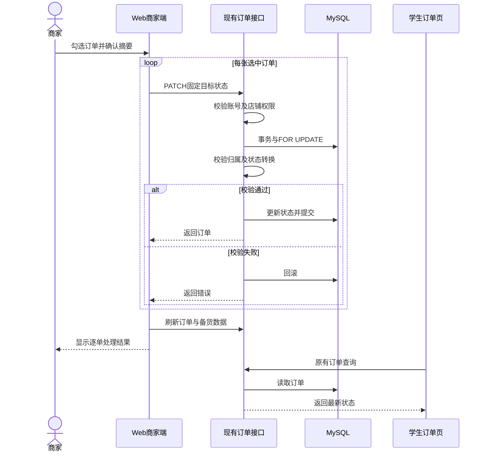
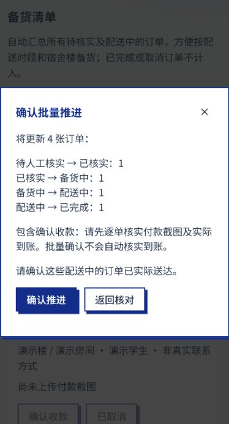

# 商家批量推进订单设计与交付计划

日期：2026-10-15。版本：1.0。状态：已实现，用户已完成本地测试，待 PR 审阅与部署。
基线：main `18cd0797`。范围：Web 商城商家端，复用现有后端订单接口。

**商家可全选已加载的可处理订单，确认后让每张订单各前进一步。**
已完成、已取消订单不参与；每张订单独立处理，部分失败不会撤销其他订单的成功结果。
本次不新增接口、表、列或环境变量。图片上传修复随本次分支一起交付，详见[图片修复设计](商品图片持久化修复设计.md)。
发布需要合并 PR 后部署 Web 与后端；推送分支本身不会使线上功能生效。
文档采用指定 [easy-output 套件](https://github.com/yejianqin61-cell/easy-output) 的 easy-plan 与可读性规则。

## 1. 问题、范围与方案

原商家端只能在每张订单上点击状态按钮。集中备货或配送时，重复操作多。
在“订单与备货”的订单列表上方增加全选、已选数量、批量推进和取消选择；每张订单增加复选框。
批量确认窗口按原状态汇总变更数量，明确确认收款和确认送达的含义。

本次不增加批量取消、自动到账核实、后台任务、跨店铺处理或 App 页面。
“全选”覆盖当前接口已加载的订单；原接口最多返回最近 1000 单，超过上限时保留原有提示。

### 复用的工程资产

| 资产 | 用途 |
| --- | --- |
| ShopAdmin 商家页 | 保留原订单和备货布局 |
| Button、Modal | 操作反馈与确认窗口 |
| shopLabels | 复用中英文状态与转换关系 |
| createShopApi.status | 复用订单状态更新请求 |
| TanStack Query | 完成后刷新商城缓存 |
| changeStatus | 复用权限、事务与状态校验 |

代码依据：`frontend/src/pages/Shop/ShopAdmin.jsx`、`ShopOrderBatch.jsx`、`shopBatchOrders.js`、`shopLabels.js`。
后端依据：`routes/shop.js` 的状态路由与商家授权中间件，`services/shop.js` 的 `changeStatus`。

### 技术取舍

| 方案 | 优点 | 代价 | 结论 |
| --- | --- | --- | --- |
| 顺序调用现有接口 | 保留校验，错误逐单可见 | 大批量耗时较长 | 本版采用 |
| 新增批量事务接口 | 一次请求、可整体提交 | 新契约与长事务成本 | 暂不采用 |
| 后台任务队列 | 关闭网页后仍可处理 | 任务追踪与运维复杂 | 后续按规模评估 |

## 2. 商家、学生与后端联动

商家在自己店铺的管理页选择订单，浏览确认摘要后提交。
前端固定本次每张订单的目标状态，逐单调用现有接口：

`PATCH /api/shop/stores/:slug/admin/orders/:id/status`

请求体保持 `{ "status": "preparing" }` 等现有格式，响应保持现有 `{ status: 0, data: order }`。
后端校验登录、账号状态和商家成员身份，再锁定订单并核对店铺归属、付款截图与允许的转换。
每张订单独立提交。前端完成后刷新商城查询，展示成功和失败数量及失败原因，并清空勾选。
学生通过原有订单查询看到数据库中的新状态；本次不新增推送或实时消息。

## 3. 状态、重复操作与异常

| 原状态 | 批量目标 | 商家确认内容 |
| --- | --- | --- |
| 待人工核实 | 已核实 | 已核对付款截图和实际到账 |
| 已核实 | 备货中 | 开始备货 |
| 备货中 | 配送中 | 开始配送 |
| 配送中 | 已完成 | 已实际送达 |
| 已完成、已取消 | 不参与 | 无 |

固定目标来自现有 `transitions` 中的非取消转换，不支持跳级。
批量确认收款不会自动证明到账；有指定付款方式而缺少截图时，现有后端返回 409。

选择记录包含订单编号和选择时的状态。后台刷新后，状态变化的订单自动退出有效选择。
确认窗口打开后固定目标；即使执行前状态变化，后端仍按最新行状态校验。
正在处理时阻止重复提交和列表状态操作，并显示已处理数量。

| 异常 | 处理 |
| --- | --- |
| 网络失败、响应丢失 | 显示该单失败，刷新后核对 |
| 重复发送同一目标 | 后端返回当前订单，不再写入 |
| 订单已推进到更后状态 | 后端拒绝回退，返回 409 |
| 无权限、其他店铺订单 | 原授权与归属检查拒绝 |
| 某单失败 | 继续其他订单，展示具体原因 |
| 完成后刷新失败 | 禁止继续操作，要求刷新核对 |
| 关闭页面、中断进程 | 已提交订单保留，未发请求不执行 |

这不是整批原子事务。再次操作前必须查看最新状态，重新勾选需要继续处理的订单。
不自动重试写请求，避免把不明确的网络结果当成未处理。

## 4. 数据库与部署配置核查

本次只使用已有订单状态列和图片地址列，不需要新增 SQL migration。
2026-10-15 使用用户提供的环境文件进行了只读检查，没有导出账号或订单数据，也没有修改表结构。

| 核查项 | 结果 |
| --- | --- |
| 订单、图片、商家所需字段 | 无缺失 |
| 订单 status 类型 | varchar(30) |
| 订单表引擎 | InnoDB |
| 店铺删除索引 | deleted_at、enabled 顺序正确 |
| 配置文件的对象存储参数 | 所需参数均存在 |
| 旧图片迁移候选 | 0 |
| 旧图缺失 | 商品 ID 4，需要重新上传 |

无需抓取整库，也不需要重复运行全部历史迁移。
只读图片检查使用 `scripts/migrate-shop-product-images.js`，未传 `--apply`。
历史可恢复图片此前已经迁移；缺失文件不能通过重复运行脚本恢复。

提交的 `.env.example` 只补充图片持久化说明，真实 `.env`、账号和备份均不进入提交。
对象存储配置文件齐全不代表部署平台配置已核对，发布者仍须检查后端的实际环境变量。
本轮不自动发布或修改部署平台设置。

## 5. easy-plan：需求清单

- R-1 选择与批量推进：来源为用户要求全选学生订单，各前进一步。
- R-2 安全与异常反馈：来源为现有状态、权限和付款校验约束。
- R-3 配置与上线核查：来源为用户要求检查数据库并保持上线可用。
- R-4 分支交付：来源为用户测试后授权生成文档、推送分支并提出 PR。

## 6. easy-plan：逐项施工方案

### R-1 选择与批量推进

- 方案：在订单列表勾选并确认，每张订单调用固定的下一状态。
- 触及模块：Web 商家订单列表、现有状态 API。
- 测试接缝：批量步骤逻辑及本地商家页面。
- 验收：全选排除终态；混合状态各前进一步；可清空选择。
- 难点：后台刷新不能把原勾选自动变成再次推进。

### R-2 安全与异常反馈

- 方案：复用后端事务和权限，逐单收集结果，阻止重复点击。
- 触及模块：商家操作反馈、现有订单服务。
- 测试接缝：订单服务入口与批量调用逻辑。
- 验收：其他商家被拒绝；重复目标不再推进；部分失败可见。
- 难点：响应丢失时必须核对实际状态。

### R-3 配置与上线核查

- 方案：只读核查已有字段与图片迁移候选，写明部署前后检查。
- 触及模块：已有数据库结构、图片迁移工具、部署配置。
- 测试接缝：只读检查、迁移测试和构建命令。
- 验收：无缺列；缺图明确报告；不重复执行无关迁移。
- 难点：本地提供的配置不能证明平台运行环境一致。

### R-4 分支交付

- 方案：保留其他工作，显式暂存本次文件，fetch 后推送个人分支并提出 PR。
- 触及模块：文档、测试与 Git 交付。
- 测试接缝：暂存差异、检查结果及 PR 目标。
- 验收：分支为 dev-sdc；PR 面向 main；不自动合并；不提交密钥。
- 难点：图片修复与本次批量功能一并交付，避免混入未完成设计文档。

## 7. easy-plan：阶段与验证

### Phase 1：商家可集中推进订单

覆盖 R-1 选择与批量推进。目标：商家可完成选择、确认、更新和查看结果。

- 打通选择一单、调用现有接口、刷新状态的最小闭环。
- 增加全选、清空选择和混合状态摘要。
- 显示处理进度与逐单结果。
- 验证手机宽度下的确认窗口。

验证：本地真实商家组件配合隔离内存数据，用户已完成本地测试。
排除：新批量 API、批量取消与 App。

### Phase 2：重复操作与失败可控

覆盖 R-2 安全与异常反馈。目标：批量处理不越权、不多推进一步。

- 打通同一目标重复发送到订单服务的验证闭环。
- 验证跨商家归属、缺截图与陈旧状态拒绝。
- 验证部分失败继续处理与顺序请求。
- 阻止处理期间重复提交和状态操作。

验证：批量逻辑、订单服务和既有路由授权测试。
排除：跨订单原子事务、后台队列与自动收款。

### Phase 3：检查环境并交付评审

覆盖 R-3 配置与上线核查、R-4 分支交付。目标：审阅者能复验并按步骤部署。

- 打通只读环境检查、生成结论、写入交付说明的闭环。
- 运行全量测试、Web 检查和生产构建。
- 检查暂存范围、截图及敏感文件排除。
- 再次 fetch，提交并推送 dev-sdc，提出面向 main 的 PR。

验证：命令退出结果、文档、分支与 PR 差异。
排除：直接推送 main、自动合并和生产部署。

## 8. 验证结果与上线验收

最终自动化检查（2026-10-15）：完整 Jest 62 套、885 项通过；Web 全量 ESLint 退出 0。
最终业务代码的 Vite 生产构建通过；后续仅补文档和截图，没有修改业务实现。
`git diff --check` 与暂存差异检查通过。构建中的既有 Shop 静态及动态重复导入提示仍存在。
本地浏览器已验证全选四种非终态、取消操作、各前进一步与成功三单失败一单的结果显示。
浏览器演示使用隔离内存数据；服务端测试使用数据库替身，没有改动真实订单。

上线顺序：核对对象存储或持久卷配置，部署后端，再部署 Web。
发布者用授权测试店铺检查上传图片、刷新后预览、学生查看、批量推进及学生查询新状态。
确认无法操作其他店铺，确认付款校验与缺图重传，确认服务重启后新图片仍可访问。
实际线上冒烟验证尚未完成，不能将本地通过写成生产已验收。

## 变更记录

- 2026-10-15：记录已测试的批量推进功能、只读数据库检查与分支交付计划。
