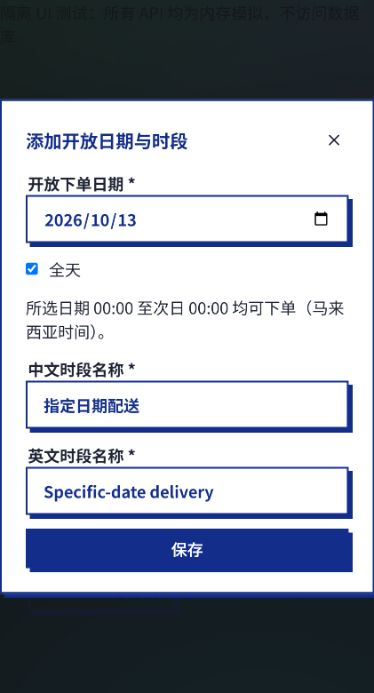

# 付款上传与 GitHub 提交准备

日期：2026-10-11。所有改动仅在本地；没有推送、部署、真实付款或发送通知。

## 完成内容

订单本人可以删除待核实订单的付款截图并重新上传。服务端事务锁定订单，核对本人、店铺及状态；重复删除安全，已核实后禁止删除或替换。商家付款码支持拖拽与选择、预览、移除引用、进度与错误反馈；上传期间禁止保存和关闭弹窗。服务端解码并规范化图片，限制5MB与1600万像素，沿用店铺权限与现有对象存储；生产环境使用本地文件时必须配置持久目录 SHOP_ASSET_DIR。旧订单保持原付款码快照，旧图片不会因改码被立即删除。

## 清理结果

已删除确认过的演示店铺、3笔订单、2张截图及5个演示账号，保留校园小店及其商家账号。删除公开演示图片、种子脚本与自动生成旧默认店铺的逻辑。本地数据库保留原名称 xmumdorm_demo，核验当前只有校园小店，无商品、时段、订单或演示账号。测试仍使用隔离临时库及合成数据，不会写入应用数据库。

## 验证

- Jest：52套、785项全部通过。
- 隔离真实MySQL/API：82项断言通过，覆盖并发库存与容量、幂等、回滚、付款码上传/读取/快照、截图删除/重传及权限隔离。
- 前端ESLint和生产构建通过；Vite保留静态与动态导入同一商城模块的分包提示，不影响构建。
- 浏览器确认商城目录只剩校园小店、付款码编辑已有上传控件。选图自动化曾被系统窗口阻塞，本轮未完成浏览器文件上传全流程及真机相册验收，不将接口测试视为这些验收的替代。已退出删除的演示账号，需用保留的商家账号重新登录。

## 提交与上线边界

提交代码、迁移、测试和文档；不得提交 .env、.local、数据库、凭据、付款截图或商家图片。Git忽略检查已确认这些本地文件受保护。应明确列出路径暂存，不能使用 git add .。本轮没有自动提交或推送。

主要新增：商城前端目录、shared/api/shop.js、routes/shop.js、services/shop.js、services/shopMerchantAccount.js、071/072迁移、商城测试与文档；还有商城入口、路由、弹窗和启动配置等现有改动，需整体审阅。操作说明见同仓库 docs/07-Implement/校园商城/本地商城说明.md。

上线前须确认商品、库存、实际收款人及二维码可扫描性、配送时间与费用、取消退款和截图留存规则。配置HTTPS、持久存储及数据库备份，并在预发布环境完成浏览器与手机验收。GitHub提交与网站部署独立，是否自动部署取决于维护者CI/CD设置。

## 2026-10-13：开放下单时间修复与全天选项

### 需求与实现

- 用户反馈原生时间控件出现“12:59”并导致时间相关报错；原控件的显示格式由浏览器地区设置决定，而服务端要求 24 小时制。本轮改为显式小时、分钟选择，避免上午/下午歧义；未取得原始报错请求，不能确认该用户历史错误的唯一原因。
- 商家在“开放下单日期”中勾选“全天”，服务端将所选日期的时间设为 `00:00:00`–`24:00:00`。按马来西亚时间，开始包含、结束不包含；当天最后一秒可下单，次日零点关闭。仅适用于所选日期，不自动开放其他日期。
- 普通时段支持 00–23 小时、00–59 分钟，结束可选择 24:00（次日零点）；禁止结束早于或等于开始。取消全天后可再次自定义。
- 复用商城 Modal、Input、表单样式、TanStack Query 刷新、现有 special-slots API 和 `shop_slots` TIME 字段。服务端仍统一决定商品页付款码展示与下单资格，不改库存、付款或商户权限。
- 实现依据：`frontend/src/pages/Shop/ShopOrderWindowFields.jsx`、`frontend/src/pages/Shop/ShopAdmin.jsx`、`services/shop.js` 的 `specialSlot` / `isSpecialSlotOpen`。原有请求不传 `all_day` 时仍按原时间字段处理；无需迁移，不修改 App 或 shared API 代码。

### 验证

- `node --experimental-vm-modules node_modules/jest/bin/jest.js --runInBand --silent`：退出码 0，56 套件、847 用例全部通过。
- `node node_modules/eslint/bin/eslint.js .`（frontend）：退出码 0。
- `node node_modules/vite/bin/vite.js build`（frontend）：退出码 0；保留既有 Shop.jsx 同时静态/动态导入提示。
- 浏览器实际打开原页面后发现本地后端未启动、商户权限加载失败。使用真实 ShopAdmin 组件与全请求内存模拟的临时测试入口，验证：选择日期→勾选全天→保存→重新编辑仍勾选；取消全天→设置 13:30–24:00→保存。临时测试入口已移除。
- 自动测试包含 00:00、12:59、23:59:59、次日零点边界、非法 24:01、反向时段、非布尔全天参数、非法日期及商户保存参数。
- 未连接生产库测试，未更改 `.env`，未创建真实商户/订单；未验证真实手机系统选择器及真实 MySQL 完整下单闭环。

